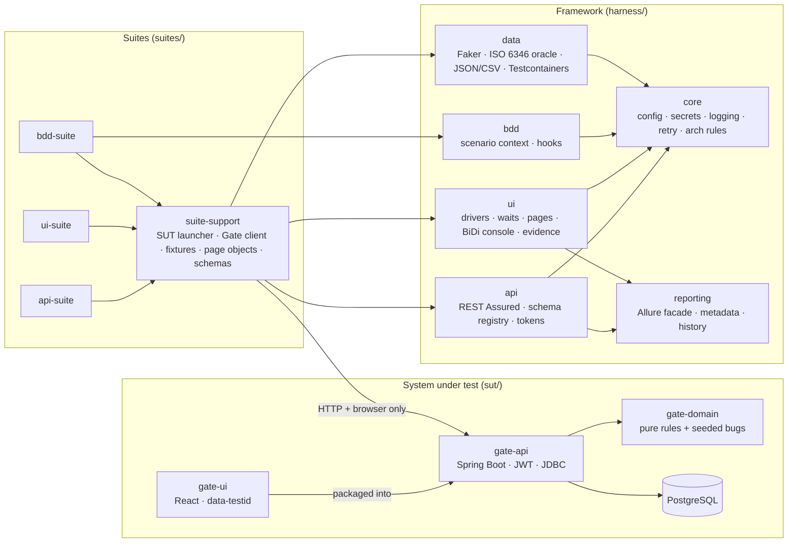

# Design decisions

Each decision states what was chosen, the alternatives considered, and why. Decisions are
numbered so code comments, commits and interviews can refer to them (`D7`).

Status legend: **Built** = implemented and exercised by tests in this repository.
**Planned** = specified for a later phase and not yet implemented.

---

## Architecture at a glance

The framework (`harness/*`) knows nothing about the Gate Appointment system. Everything
Gate-specific — the launcher, typed client, schemas, page objects — lives in
`suites/suite-support`. That boundary is what lets the Phase 4 PortSync adapter reuse the
framework unchanged.

---

## SUT

### D1 — Bundle a realistic SUT with deliberately switchable defects — Built
- **Chosen:** a small Gate Appointment system (Spring Boot 3.5 API, PostgreSQL, React UI)
  with six documented seeded defects, switchable at runtime through a test-support API.
- **Alternatives:** test a public demo site (e.g. a shop demo); test only mocks.
- **Why:** a demo site can't be broken on purpose, so it can never prove a suite *catches*
  anything. Owning the SUT makes the fault-seeding experiment (Phase 3) possible: switch a
  bug on, run everything, record who noticed.
- **Trade-off:** more code to own; the SUT is deliberately small.

### D2 — Seeded bugs are branches beside the correct code, not separate builds — Built
- **Chosen:** each defect is an `if (bugs.isEnabled(X))` branch next to the correct line
  (`CapacityPolicy`, `ContainerNumber`, `SlotTimes`, `BookingAccessPolicy`,
  `BookingService`). `MutableBugSwitches` swaps an immutable `EnumSet` atomically.
- **Alternatives:** git branches per bug; bytecode mutants; feature-flag service.
- **Why:** one binary, toggled per run without redeploying, so the experiment is cheap to
  repeat. Every bug is unit-tested in both states (`*Test` in `gate-domain`).
- **Trade-off:** the defects are visible in the source; they are documented as such.

### D3 — Plain JDBC with an explicit row lock instead of JPA — Built
- **Chosen:** `JdbcClient` with hand-written SQL; capacity checks take
  `SELECT … FOR UPDATE` on the slot row before counting and inserting.
- **Alternatives:** JPA with `@Version` optimistic locking; a stored counter column.
- **Why:** the race on the last place is one of the seeded bugs, so the concurrency control
  must be explicit and readable. Occupancy is *derived* (`count(*)` of BOOKED/CHECKED_IN
  rows) so there is no counter to drift. Proven by `GateApiIntegrationTest`: 8 concurrent
  drivers, capacity 1 → exactly 1 succeeds; with `RACE_ON_LAST_SLOT` → more than 1.
- **Trade-off:** more SQL to maintain than JPA; acceptable at this size.

### D4 — RFC 9457 problems with a stable machine-readable `code` — Built
- **Chosen:** every error is `application/problem+json` with `code` (see `docs/errors.md`).
- **Alternatives:** status codes only; free-text messages.
- **Why:** tests assert on `code`, so messages can change without breaking tests, and two
  different 409s (`SLOT_FULL` vs `DUPLICATE_ACTIVE_BOOKING`) are distinguishable.
- **Evidence it matters:** the strict schema check (D10) found that Spring's built-in
  problem-details advice pre-empted the app's handler for 14 kinds of 4xx and dropped
  `code`. Fixed in commit `9cc795c`.

### D5 — Object-level authorisation answers 404, not 403 — Built
- **Chosen:** a driver requesting another driver's booking gets `404 NOT_FOUND`.
- **Why:** 403 would confirm the reference exists (an enumeration aid). Tests assert the
  404 for read, reschedule and cancel (IDOR cases).

### D6 — A keyed, off-by-default test-support API — Built
- **Chosen:** `/api/test-support/*` (bug switches, clock offset, throw-away users) exists
  only when `gate.test-support.enabled=true` (404 otherwise) and requires
  `X-Test-Support-Key` (constant-time comparison). Compose binds ports to `127.0.0.1`.
- **Alternatives:** direct DB writes from tests; a separate admin service.
- **Why:** tests need per-test users and time travel without coupling to the schema.

### D7 — Time travel through a shiftable clock, used only in `@Isolated` tests — Built
- **Chosen:** the app's `Clock` bean is a `ShiftableClock`; tests that need "the slot
  ended 31 minutes ago" shift it via the test-support API inside an `@Isolated` class
  (JUnit runs it alone), and reset it in `@AfterEach`.
- **Alternatives:** sleeping until the time passes (forbidden, see D12); per-request clock
  headers.
- **Why:** check-in "too late" and "booking a started slot" are otherwise untestable.
  Tokens use wall-clock time so time travel cannot expire a test's session.

---

## Framework

### D8 — Layered configuration with recorded origins; secrets only from env vars — Built
- **Chosen:** `harness-defaults.yml` (framework) → `harness.yml` (project) →
  `harness-<env>.yml` (`local`/`docker`/`ci`) → `HARNESS_*` env vars → `-Dharness.*`.
  `HarnessConfig.origin(key)` says which layer won. `secret(NAME, localFallback)` reads only
  the environment; in `ci` a missing secret is an error, never a fallback.
  `Secret.toString()` is `NAME=****`.
- **Alternatives:** Spring profiles inside tests; Typesafe Config; a single properties file.
- **Why:** no framework dependency for config, explicit precedence, and a missing CI secret
  fails loudly instead of silently using a dev default.

### D9 — The SUT is booted in-process for local/CI runs, external for Docker — Built
- **Chosen:** `GateSut` (in `suite-support`) starts PostgreSQL in Testcontainers and the
  Spring Boot app in the test JVM on a random port (`sut.mode=embedded`); with
  `HARNESS_ENV=docker` it targets `http://localhost:8080` instead. Tests still use only
  HTTP and a real browser.
- **Alternatives:** always Docker Compose; a Spring `@SpringBootTest` per suite.
- **Why:** one command (`mvnw verify`) needs no Compose; start-up is ~10 s; and because the
  SUT runs in the test JVM, JaCoCo can attribute SUT lines to individual tests — the basis
  for Phase 3 test-impact analysis. The Compose path is exercised in CI (`compose-smoke`).
- **Bug found while building it:** `SpringApplicationBuilder.properties()` only sets
  lowest-precedence defaults, so `application.yml` won and the app tried `localhost:5432`.
  Settings are now passed as command-line arguments; a failed start is remembered so later
  tests fail fast with the original cause (commit `c0598f1`).

### D10 — Every response is validated against a JSON Schema — Built
- **Chosen:** a REST Assured filter validates each response against the schema registered
  for its `method + path + status` in `schemas/registry.yml` (draft 2020-12, format
  assertions on, `$ref` across files via `classpath:` URIs, using networknt
  json-schema-validator). In `strict` mode an unregistered operation fails the test.
  Catch-all rules (`* ** 4xx`) make every error on every path a problem document.
- **Alternatives:** REST Assured's own `json-schema-validator` (draft-04 only); asserting
  fields by hand per test.
- **Why:** contracts are checked uniformly, even by tests that are "about" something else.
  A violation is an `AssertionError` (a *failed* test — a product/contract defect — not a
  *broken* one).

### D11 — Independent test oracles — Built
- **Chosen:** `harness-data`'s ISO 6346 generator/validator uses the standard's letter
  table verbatim; it shares no code with the SUT's `ContainerNumber`.
- **Why:** if tests reused the SUT's check-digit code, a defect there (seeded bug
  `CHECK_DIGIT_EDGE_CASE`) would be reproduced by the tests and never detected.

### D12 — Explicit waits only, enforced by architecture tests — Built
- **Chosen:** `Waits` wraps `WebDriverWait` with a described condition for every wait;
  implicit waits are forced to zero by `DriverFactory`. ArchUnit rules
  (`HarnessArchRules`) fail the build on `Thread.sleep`, `TimeUnit.sleep`, `System.out/err`,
  and on `LockSupport.park*` anywhere except `core.retry.Pause` — the one audited place that
  blocks, used only for retry back-off and condition polling. `ArchRulesSelfTest` proves each
  rule fires on a deliberately bad class.
- **Why:** fixed sleeps are the commonest cause of slow, flaky UI suites.

### D13 — Retry is for infrastructure, never for assertions — Built
- **Chosen:** `Retry` requires an explicit attempt cap (1–10) and an explicit predicate of
  retryable failures; everything else fails immediately. There is no "retry failed test".
- **Why:** retrying assertions hides flakiness. Phase 3 measures and quarantines flaky
  tests instead.
- **Browser start-up is infrastructure too** (Phase 2): `Drivers` retries session creation
  once on `SessionNotCreatedException` only (`ui.session-attempts`), and creates the first
  session per browser and target alone so driver resolution is not raced by every worker.
  Added after four parallel first starts of Edge failed together in CI; tested without a
  browser in `DriverStartPolicyTest`.

### D14 — One browser per thread, data isolation per test — Built
- **Chosen:** `Drivers` holds a `ThreadLocal` session; JUnit 5 runs classes and methods
  concurrently (4 workers API, 2 UI locally, overridable). Each test creates its own users
  (test-support API) and slots in a lane nobody else uses (`UniqueIds`), so tests never
  share rows. Tests that change global state are `@Isolated`.
- **Alternatives:** reset the database between tests; serial UI tests.
- **Why:** parallel-safe by construction rather than by luck; no global teardown needed.
  Fixed-value data (e.g. the ISO worked example `CSQU3054383`) is cancelled after use so
  runs against a persistent Compose database stay repeatable.

### D15 — Cross-browser console capture over WebDriver BiDi — Built
- **Chosen:** every driver is created with `webSocketUrl=true`; `BrowserConsole` subscribes
  to console entries and uncaught JS errors via `LogInspector`.
- **Alternatives:** Chrome `goog:loggingPrefs` (Chrome/Edge only).
- **Why:** identical evidence in Chrome, Firefox and Edge. Verified in Chrome 154 and
  Firefox 157 by `RealBrowserTest`. If BiDi is unavailable the report says so instead of
  showing an empty log.

### D16 — Evidence is captured before the browser closes — Built
- **Chosen:** `BrowserExtension` captures screenshot, page HTML, URL and console in
  `afterTestExecution` (before `afterEach` quits the browser), attaches them to Allure and
  writes them under `target/evidence/<test>/`. Capture errors are logged, never thrown, so
  they cannot mask the real failure.

### D17 — UI journeys sign in through an API token — Built
- **Chosen:** apart from the login tests themselves, journeys put a token from the API into
  `sessionStorage` and start on the page under test.
- **Why:** a broken login form then fails the login tests only (clear signal) and the UI
  suite is faster.

### D18 — Native date inputs are set through the value setter, then verified — Built
- **Chosen:** `Inputs.setDate` uses the native `HTMLInputElement.value` setter and
  dispatches `input`/`change` (what React listens for), then asserts the value took.
- **Why:** typing into `<input type="date">` depends on the browser's locale order. This is
  the one place the framework uses JavaScript to drive the page; it is documented as such.

### D19 — Page objects + components scoped to a root — Built
- **Chosen:** `BasePage` (knows its ready-locator and path) and `Component` (all lookups
  scoped to a root). `SlotPicker` is one class used for both the booking form and the
  reschedule panel, selected by a `data-testid` prefix.

### D20 — Allure as the single report, generated through its Java entry point — Built
- **Chosen:** all suites write to `target/allure-results`; `mvnw -N -Preport verify`
  unpacks the Allure CLI from the Maven repository and runs `io.qameta.allure.CommandLine`
  with `java`, then saves `history/` for trend charts.
  `categories.json` buckets failures as locator / timeout / environment / schema /
  assertion / unexpected exception.
- **Alternatives:** `allure-maven`'s `report` goal (a Maven *site* report — needs a site
  skin and failed offline); shelling out to `bin/allure` (differs on Windows).

### D21 — Cucumber state through PicoContainer and a typed context — Built
- **Chosen:** `ScenarioContext` with typed keys (`Key.of("booking reference", String.class)`)
  injected per scenario; a missing value says which Given step is probably missing. A
  `{time}` parameter type turns `09:30` into a `LocalTime`.

---

## Phase 2 — Grid, visual, accessibility, contracts, performance, security

### D25 — Selenium Grid in Compose; browsers address the SUT by service name — Built
- **Chosen:** `docker-compose.grid.yml` overlays a hub and Chrome, Firefox and Edge nodes
  (`selenium/*:4.51.0-20261010`) on the SUT stack. Tests run on the host and send HTTP to
  `sut.base-url` (`localhost:8080`), but the browsers live in node containers, so pages are
  opened at a separate `sut.browser-base-url` (`http://gate:8080`). Nodes advertise
  `SE_NODE_GRID_URL=http://localhost:4444` so BiDi WebSockets (console capture, D15)
  resolve from the test JVM.
- **Alternatives:** Selenoid / Moon (third-party, less current); running tests inside the
  Compose network (hides the host↔container split the Windows setup actually has).
- **Why / evidence:** the split URL found a real test bug (two deep-link tests used the API
  URL — invisible locally, `ERR_CONNECTION_REFUSED` on Grid). Without the advertised URL
  every BiDi connection failed (the hub handed out its container IP;
  SeleniumHQ/selenium#15610).
- **Measured:** RESULTS.md §Phase 2, "Grid".

### D26 — Visual regression: own perceptual diff, per-platform baselines, CI-rendered and reviewed — Built
- **Chosen:** `ImageDiff` compares element screenshots with the YIQ colour distance used by
  pixelmatch (threshold `visual.pixel-tolerance` = 0.1 of the maximum YIQ delta), then fails
  if more than `visual.max-mismatch` (0.2 %) of compared pixels differ. Child elements whose
  content legitimately changes (dates, generated lanes, references, usernames) are passed
  as ignore-regions. On failure the report carries baseline, actual and a red diff image.
- **Baselines** are per *platform* (`chrome-ci`, `firefox-ci`, `edge-ci`, and `chrome-windows-ci`, `edge-windows-ci` on the Windows runner): font rendering
  differs between browsers and operating systems, so one baseline per browser would
  either fail on every other machine or need a tolerance loose enough to miss real
  changes. `visual-baselines.yml` renders candidates on the CI image and pushes them to a
  `visual-baselines/<run>` branch; a person reviews the PNGs and merges — **merging is the
  approval step**. Locally a missing baseline writes a candidate and skips; in the `ci` environment
  `visual.require-baseline` defaults to true, so a missing baseline fails.
- **Stabilisation before every capture:** blur the focused element; freeze carets,
  transitions and animations. `:focus-visible` paints only when the window has OS focus,
  which varies between parallel headless sessions (2.0–3.5 % differences in CI before this).
  Trade-off: focus styling is not asserted visually.
- **Deterministic layout:** the booking-form check uses a date no other test uses; the slot
  list above the form otherwise changed its sub-pixel position and border anti-aliasing
  (2.76 % in CI; reproduced locally at 0.78 %; 0 px after the fix in two full runs).
- **Alternatives:** Applitools / Percy (hosted, paid, not reproducible offline); pixel-exact
  comparison (fails on harmless anti-aliasing); pixelmatch's anti-aliasing detection —
  *not implemented*, which is why layout determinism is enforced in the tests instead.
- **Simplified:** no anti-aliasing detection; five components, not every screen.

### D27 — Accessibility: axe-core on every page *state*, gate on critical and serious — Built
- **Chosen:** `A11yScanner` runs axe-core (`com.deque.html.axe-core:selenium` 4.13.0)
  restricted to the WCAG 2.0/2.1 A and AA tags, writes `target/a11y/<page>-<browser>.json`
  and fails on any *critical* or *serious* violation (`A11yGate`, thresholds configurable;
  moderate/minor are reported, not gated). Nine states are scanned — including the
  validation error, the reschedule panel, the confirm dialog and the check-in notice —
  because dialogs and error messages are where accessibility usually breaks.
- **Proof the scanner works:** `RealBrowserTest` scans a fixture page with known faults and
  asserts `image-alt`, `label` and `color-contrast` are reported and the gate fails.
- **Limits:** automated rules find a subset of WCAG failures; no screen-reader or
  keyboard-only walkthrough is automated. Best-practice (non-WCAG) rules are not run.

### D28 — Consumer-driven contracts from the UI's real client, committed with a drift check — Built
- **Chosen:** Pact V4. The consumer test (`client.pact.test.js`, Pact JS in Vitest) calls the
  UI's own `api/client.js` against the Pact mock server — so the contract is what the UI
  really sends and parses, not a hand-written copy. The pact file is committed under
  `contracts/pacts/`; CI regenerates it and fails on `git diff` (drift check). The provider
  (`PactProviderTest` in `gate-api`) verifies it against the real app and PostgreSQL;
  provider states create fixed ids and pin the clock to 2026-11-20 09:00 terminal time so
  the contract's dates never expire.
- **Alternatives:** a Pact Broker / PactFlow (the right choice for many teams and repos;
  overhead for one repo); Spring Cloud Contract (provider-driven, JVM-only consumer).
- **Found:** mixed timestamp precision in the SUT (D32).

### D29 — Performance smoke with Gatling's Java DSL and hard gates — Built
- **Chosen:** `BookingFlowSimulation` drives login → list slots → book → read → cancel with
  an open ramp (default 60 users over 30 s) against the embedded SUT, and fails the build if
  p95 ≥ 800 ms, p99 ≥ 1500 ms or errors ≥ 1 % (all overridable with `-Dperf.*`). Test data
  (30 drivers, 10 slots) is created through the API before load starts.
- **Reporting:** Gatling 3.16 writes no `stats.json` and a binary `simulation.log`, so CI
  parses the console's final *Global Information* block and per-request table.
- **Netty pin:** Gatling 3.16 needs Netty 4.2 while Spring Boot 3.5 manages 4.1; the
  perf module imports `netty-bom` 4.2.18 (otherwise `NoClassDefFoundError: io/netty/channel/IoHandle`).
- **Simplified — this is a smoke test, not a capacity test:** the SUT shares the runner
  with the load generator, so numbers show regressions between runs on the same machine,
  not production capacity.

### D30 — Security smoke tests, not a penetration test — Built
- **Chosen:** `SecuritySmokeTest` (17 tests, `@Tag("security")`): `alg=none` and
  foreign-key JWTs, wrong schemes and empty tokens; cross-driver read/move/cancel (IDOR);
  driver use of clerk operations; mass assignment of `status`/owner; hostile references
  (path traversal, encoded slashes, SQL); SQL injection in login; script payloads never
  reflected; security headers; errors without stack traces; test-support API unreachable
  without its key.
- **Not covered (honestly):** no DAST scanner (e.g. ZAP), no fuzzing, dependency CVE scan
  yet: a `dependency-review` job is in CI, but it needs the repository's dependency graph
  switched on (it failed with "not supported on this repository" in run 38864791578), so it
  runs only once the repository variable `DEPENDENCY_REVIEW=true` is set; no rate-limit /
  brute-force tests.
- **Found:** firewall and Tomcat rejections were not RFC 9457 problems (D33).

### D31 — Strict schema mode can register a deliberately non-JSON response as `none` — Built
- The SPA routes (`/login`, `/driver`, `/clerk`) return HTML. Instead of switching strict
  validation off for UI-adjacent tests, the registry says so explicitly
  (`schema: none`); anything else unregistered still fails.

### D32 — Every timestamp has whole-second precision — Built (SUT fix)
- Found by Pact provider verification: slot times had whole seconds, but audit fields and
  token expiry carried micro/nanoseconds, so one client format could not parse all of
  them. All times are now truncated to seconds and the shared schema enforces the format.

### D33 — Rejected URLs answer with the same problem+json contract — Built (SUT fix)
- Found by the security tests: paths with `;`, an encoded `%` or an encoded `/` were
  refused by Spring's `StrictHttpFirewall` or by Tomcat with a bare/HTML 400. A
  `RequestRejectedHandler` writes a `VALIDATION_FAILED` problem, and Tomcat passes `%2F`
  through so the firewall (which still rejects it) handles it consistently.

---

## Phase 3 — measuring the suites, and tools that use the measurements

### D34 — Fault seeding as a CI experiment, credited only against a green baseline — Built
- **Chosen:** `fault-seeding.yml` runs eight suite types (contract, API functional, security, UI
  journeys, accessibility, visual, BDD, Gatling) once with no bug and once per seeded bug, in
  parallel jobs. A suite *catches* a bug only if it has failures with the bug **and** passed on
  the baseline, so a flaky or broken suite cannot take credit. Results are committed to
  `experiments/fault-seeding/` with every failing test and its message.
- **Not in the matrix:** domain unit tests switch bugs on themselves (they test both states by
  design) and the SUT integration tests; including them would measure nothing new.
- **Measured:** RESULTS.md §Phase 3.

### D35 — Run history as JSON Lines first, PostgreSQL second — Built
- **Chosen:** a ServiceLoader-registered JUnit `TestExecutionListener` (`HistoryListener`)
  records every result (key, display name, status, duration, failure class and cause, commit,
  branch, suite, environment) to `target/test-history/*.jsonl`, and also to PostgreSQL when
  `history.jdbc-url` is set. Inserts are idempotent, so history can be rebuilt from archived
  files. A history problem is logged and never fails a build.
- **Why both:** files need no infrastructure on a laptop; the database is what CI and the
  dashboard query.

### D36 — Flakiness = flips on the same commit; quarantine is a discovery filter — Built
- **Score** = pass↔fail flips between consecutive runs **of the same commit** ÷ transitions.
  Passing on one commit and failing on the next is a regression and is not counted; always
  failing is broken, not flaky. A test needs ≥ 5 runs and a score ≥ 0.2 (configurable) to be
  quarantined.
- **Quarantine** is a `PostDiscoveryFilter` reading `quarantine.json`:
  `quarantine.mode=exclude` for blocking jobs, `only` for the non-blocking quarantine job,
  `off` (default) locally so developers still see every failure. Quarantined tests keep
  running and keep producing history, so they leave quarantine when they become stable.
- **Alternatives:** JUnit `@Disabled` edits (manual, silent), retry-until-green (hides real
  intermittent bugs — the race in this SUT would be hidden by a retry).
- **Found while building:** parameterised tests are *containers* at discovery time, so the
  first filter version let them through every filter.
- **Found while running the experiments:** a run with seeded bugs switched on is not the code
  at its commit. Recorded under the plain SHA, every deliberate failure from the fault-seeding
  and TIA experiments looked like a same-commit flip (the local leaderboard briefly showed 20
  "flaky" tests). Such runs are now recorded as `<sha>+seeded:<bugs>`.

### D37 — Failure causes from the exception chain — Built
- `FailureClassifier` buckets a failure as locator, timeout, assertion, environment, data or
  unknown by exception *class names* along the cause chain (no Selenium/JDBC dependency), in a
  deliberate order: environment first (a dead browser also times out), then locator (a wait that
  never found its element is a locator problem, not a slow page), then data, timeout, assertion.

### D38 — Self-healing that reports instead of hiding — Built
- **Chosen:** `Target` = name + ranked strategies (data-testid, id, accessible name computed by
  the browser, text, nearest-below). The primary must match exactly one element — two matches is
  a test bug and fails, never heals. A fallback is used only on exactly one match. A heal is
  logged as a warning, shown as a yellow step, tagged `healed`, written to
  `target/healing/healing.jsonl`, and carries a fix read from the element actually found (its
  current data-testid). `ui.healing=fail` diagnoses but fails; `off` disables fallbacks.
- **Alternatives:** ML-based healing products (opaque; heal by similarity score and can click
  the wrong element), or no healing (a renamed test id fails with "no such element" and no
  hint).
- **Evidence:** the real-app demo renames `book-submit` in the live page; the page object books
  through the accessible-name fallback and the report names `book-button` as the fix. In a full
  UI run, the demo is the only heal.

### D39 — Test impact analysis from per-test coverage of the in-process SUT — Built
- **Chosen:** with `tia.record=true` and sequential execution, `TiaRecorder` resets and dumps the
  JaCoCo agent around each test. Because the embedded SUT runs inside the test JVM, server code
  reached over HTTP or through the browser is attributed to the test that caused it. `TiaMapper`
  keeps only SUT classes; `TiaSelector` maps a diff to tests with conservative rules (build,
  framework, test and resource files → everything; frontend → all UI/BDD; SUT files no test
  executes → flagged as untested) and explains every decision.
- **Refuses** to record with parallel tests: coverage of concurrent tests cannot be separated,
  and a wrong map is worse than none.
- **Limits:** the first test that boots the SUT is attributed the start-up code; JavaScript has
  no per-test coverage (frontend changes select all UI tests).
- **Found by the experiment:** selection and sharding read `harness.select`/`harness.shard`
  while `HarnessConfig` strips the prefix — a "selected" run silently ran everything.

### D40 — Mutation testing on the domain rules only — Built
- PIT with the `STRONGER` mutator set on `gate-domain` (the rules the seeded bugs live in),
  in a `mutation` profile, failing below 95 %. Not on the whole SUT: mutating Spring wiring
  produces mostly equivalent or untestable mutants and takes many times longer.

### D41 — AI assistance is optional, provider-agnostic and draft-only — Built
- Two wire protocols cover most providers (OpenAI-compatible chat completions — also Ollama,
  LM Studio, Groq — and Anthropic messages); `ai.provider`, `ai.model`, `ai.base-url`, key only
  from `HARNESS_AI_API_KEY`. No model name is guessed.
- **Gherkin drafts** reuse the suite's existing step phrases, are parsed with the Gherkin
  parser, get a banner saying who wrote them and that a person must review them, carry
  `@draft`, and are written only to `target/ai-drafts/` — never into the source tree.
- **Failure summaries** are deterministic without a model (grouped by classified cause, with
  evidence paths and console tails); a model adds a section marked "DRAFT … unverified".
  Screenshots are sent only with `--send-screenshots`.
- **Not done:** no run against a real provider in this repository (no key in the authoring
  environment); request/response formats are tested against stub servers.

## Phase 4 — the dashboard, the CLI and a second system under test

### D42 — The dashboard is one static page fed by files the build already writes — Built
- `th dashboard` (`DashboardData`) reads what the build and experiments leave on disk —
  history JSONL, JaCoCo CSV, PIT XML, axe JSON, visual candidates and diffs, healing records,
  experiment JSON — plus PostgreSQL history if asked, and writes `data.json` and `data.js`
  beside a prebuilt page. A missing source empties its panel and is listed under "Data
  sources"; nothing is estimated or back-filled.
- The React app is built (Vite) into **one** `index.html` with script and styles inlined, and
  that file is committed into `harness-insights` resources, so the framework needs no Node and
  the page opens from disk (`file://`) — `data.js` is a classic script for the same reason. CI
  rebuilds it and fails if the committed page differs from its source.
- **Alternatives:** Grafana (needs a server and a datasource for every artefact type), Allure
  trends (only pass/fail history; no flakiness, mutation, TIA or detection matrix), a served
  SPA (one more process to run for a read-only page).
- Charts are hand-written SVG (no chart library) on the reference dataviz palette, validated
  for light and dark; status is always icon + word; every chart has a table view.

### D43 — One run id per Maven build — Built
Each module's tests run in their own JVM, so a per-JVM run id split one `mvnw verify` into a
dozen "runs". The root POM passes `harness.run.id=${maven.build.timestamp}` to every surefire
fork; the CLI and CI can still set their own.

### D44 — A second SUT through an adapter, without touching the framework — Built
- `adapters/portsync` drives PortSync (Kafka, PostgreSQL, Spring Boot, React; no logins, no
  test ids) with the unchanged `harness/` modules: its own config keys, clients on
  `ApiSpecs`, a strict schema registry and page objects with `Target`s.
- The adapter **never starts PortSync** — it needs Kafka, and PortSync's own Compose file is
  the supported way to run it. The adapter waits for readiness the way PortSync's smoke test
  does (core ready, simulator running, opening inventory processed) and remembers a failure so
  later tests fail fast.
- **Differential testing** is the strongest check available on a system I did not design the
  rules of: PortSync's ISO 6346 validator, its dashboard's validator and TestHarness's oracle
  are three independent implementations asked about the same numbers.
- Live tests are excluded unless `-Dportsync.live`, so `./mvnw verify` stays self-contained.

### D45 — The new-test guide is executable — Built
`docs/NEW_TEST_IN_5_MINUTES.md` walks through a real change (J and Z container categories,
which no test covered, plus a direction-echo test) that is committed and passing, so the guide
cannot drift from the code without a test noticing. Writing it exposed that the ArchUnit
rules only covered `harness/`; they now run in every suite and the adapter.

## Phase 5 — the pipeline

### D46 — Shard by a stable hash of the test key — Built
The UI suite runs as 3 browsers × 2 shards. `ShardFilter` keeps a test when
`CRC32(key) mod n = k-1`, so a test always lands in the same shard and its history stays
comparable across runs, and no coordinator is needed. **Measured:** the CIForge run's shards
ran 15 and 14 of the 29 UI tests — nothing lost or duplicated. **Trade-off:** shard durations
are uneven (a hash knows nothing about duration); a split balanced on recorded durations is the
next step once enough history exists per test.

### D47 — One quality gate; quarantine is visible and never blocking — Built
- Blocking jobs run with `quarantine.mode=exclude` against the committed `quarantine.json`; a
  separate job runs `quarantine.mode=only` with `continue-on-error`, so quarantined tests keep
  producing history (and can leave quarantine) without ever failing a build.
- `quality-gate` is the one check to require on `main`. It reads the `needs` context and
  passes only if every blocking job **succeeded** — a skipped or cancelled job counts as not
  passed, because "did not run" is not evidence. The quarantine job is listed in its summary
  but cannot fail it.
- **Alternatives:** branch protection listing every job (brittle: renaming a matrix entry
  silently drops it from protection), `if: failure()` aggregators (pass when a needed job is
  skipped).

### D48 — The same pipeline in three CI systems, each honest about how far it ran — Built
- **GitHub Actions** (`.github/workflows/ci.yml`) is the pipeline of record.
- **CIForge** (`.ciforge.yml`) — my own TeamCity-style orchestrator — ran the full chain on the
  authoring machine: 9 builds, snapshot and artifact dependencies, 8 min 11 s, green
  (`experiments/ciforge`). Its quality gate counts suite results from artifacts, not from a
  shared disk.
- **TeamCity** (`.teamcity/settings.kts`) models the same chain: snapshot dependencies, a
  composite quality-gate build, a non-blocking quarantine build, a "test count dropped by 20 %"
  failure condition. See D49 for how far it was verified.

### D49 — The TeamCity DSL is compiled for real, against a throwaway server — Built
The Kotlin DSL library is not on any public Maven repository in a usable form: a TeamCity
server serves it, including classes generated from that server's plugins (`script`,
`xmlReport`, …). So the CI job starts `jetbrains/teamcity-server:2025.07`, waits for it, and
runs `teamcity-configs:generate` against its DSL repository. This turned up three real problems
a reader would never have seen: a dependency-version mismatch, a Kotlin 2.0 compiler crash on
`BuildType` subclasses with default constructor arguments, and objects that capture the script
instance (rejected by the DSL compiler). **Limit:** generating the configuration is not running
it — no TeamCity agent has executed these builds.

---

## Phase 6 — closing the gaps

### D50 — Shards balanced by recorded duration, computed independently by every shard — Built
D46's hash split is stable but blind to test length. `ShardPlan` assigns tests longest first to
the currently lightest shard (LPT), with ties broken by key and shard index, so every shard
derives the *same* plan from the same durations file and no coordinator is needed. Durations
are the mean per-run total of a test key, where a run is a run id in one environment (CI jobs
for different browsers can share a run id). Tests missing from the file (new ones) fall back to
the hash, so a stale file never loses or duplicates a test. The file comes from main's history
(D51); a pull request uses whatever main last recorded. *Rejected:* a dynamic work queue —
it balances perfectly but needs a broker, and breaks "one test, one shard" for history.

### D51 — CI history lives on a branch, the dashboard on gh-pages — Built
After every pipeline on main, a `publish` job appends the run's JSON Lines history (all jobs,
per job directory) to the `ci-history` branch, keeps a sliding window of 120 runs, and derives
`shard-durations.json`, the flakiness leaderboard and a quarantine *proposal* (quarantine.json
itself stays a reviewed file, D37). It then builds the dashboard from that window, adds the
Allure report and the blog, and force-pushes the site to `gh-pages`. *Why a branch:* no
external storage, no secrets, every change is a reviewable commit, and the data outlives
artifact retention. *Limit:* GitHub Pages must be switched on once in the repository settings
(source: `gh-pages`); a workflow token cannot do that.

### D52 — Test impact analysis on pull requests, recorded on main — Built
`tia-map` records per-test coverage on every push to main and stores the map in `ci-history`;
the `impacted` job on a pull request selects with `th tia select --base origin/<base>` and runs
that subset first. It is feedback, not a gate: the full suites still run (D39's measured
savings were 4–33 % over three recordings, too little to skip anything on merge).

### D53 — Sign-in throttling in the SUT, tested from three sides — Built
Five failures per username or 100 per client address within 15 minutes lock that key for
5 minutes (429 `TOO_MANY_ATTEMPTS`, `Retry-After`). The lock is checked *before* the password
so a correct guess during a lock reveals nothing, and unknown usernames lock like real ones.
It uses the wall clock, not the test-shiftable clock. *Trade-off accepted:* anyone can keep a
known username locked; per-user locks always allow that, so the lock is short. The tests found
that Apache HttpClient 5 (used by TestRestTemplate) honours `Retry-After` on 429 by sleeping
and retrying — a client-side behaviour worth knowing when testing rate limits.

### D54 — Dependency scanning from a Maven-resolved SBOM, with version floors — Built
OSV-Scanner's own pom resolution could not resolve this reactor (5 packages per module), so
Maven resolves the graph into a CycloneDX SBOM and OSV-Scanner reads that plus the npm
lockfiles. The first full scan found 41 advisories in 18 transitive packages; the root pom now
declares "security floors" ahead of the Spring Boot BOM, and the scan fails on anything new.
Advisories with no open-source fix on the Spring Boot 3 line are ignored only with a written,
code-checked reason and an expiry date (osv-scanner.toml).

### D55 — ZAP baseline as a gate, findings fixed rather than ignored — Built
The first scan raised eight alert types; the six about headers (CSP directives without a
fallback, inline styles, Permissions-Policy, COOP/COEP/CORP) were fixed in the SUT. Only
informational rules are triaged in `.zap/rules.tsv`, each with its reason. ZAP runs from its
image directly so its WARN/FAIL lines reach the job log.

### D56 — A Windows job that runs the Windows guide — Built
`windows.yml` executes the commands of docs/WINDOWS.md with `mvnw.cmd` and `th.cmd` in
PowerShell, with the UI suite in Chrome and Edge. Hosted Windows runners cannot run Linux
containers, so the runner's PostgreSQL stands in for Testcontainers through
`-Dharness.db.url` — the same switch the Compose setup uses. It found two real problems:
`install -DskipTests` still ran Gatling, and a framework test assumed a container.

### D57 — The AI drafter is measured against real models, by step reuse — Built
`ai-eval.yml` serves open models with Ollama on the runner and drafts a feature for each user
story in `experiments/ai/stories`. Drafts are scored by `DraftStepCoverage`, which matches every
drafted step against the BDD suite's real step definitions the way Cucumber does (a dry run
was rejected: it skips every step after the first undefined one). The score that matters is
step reuse — how much of a draft runs without new glue — not how plausible it reads.

### D58 — Capacity is measured on fixed resources, separately with and without sign-in — Built
`tools/capacity.py` steps an open arrival rate against the SUT in Compose limited to 2 CPUs and
1 GiB, so the result means "on 2 CPUs" rather than "on whichever runner". Two flows differ only
by the password check on the request path, which isolates the cost of bcrypt. A level keeps up
when errors < 1 %, p95 ≤ 800 ms and completed flows ≥ 95 % of offered.

### D59 — A consumer contract with PortSync that needs no provider states — Built
The adapter's real `CoreApi` (strict schemas on) generates the pact against Pact's mock server;
it contains only interactions that hold on any running PortSync (overview shape, check-digit
validation, error codes), so the live verification needs no state handlers in a repository we
do not control. The SLA scenarios (gate surge, vessel surge, SSE, paused-yard agreement) run
isolated because they change the whole terminal.

### D60 — TeamCity runs the real settings, compiled by TeamCity — Built
`teamcity.yml` starts a TeamCity 2025.07 server and an agent image (JDK 21, Docker, Chrome),
creates the project over REST and enables versioned settings in Kotlin, so the *server*
imports and compiles `.teamcity/settings.kts` from the branch — the same path a real
installation takes. The seed password moved from a credentials token in the DSL to the agents'
environment.

### D61 — Releases are cut by a workflow — Built
`release.yml` refuses to run off main, re-use a tag or release without a CHANGELOG section; it
publishes the source archive, the SBOM and, given a pipeline run, its Allure report and site.

### D62 — Known accessibility issues are matched like CSS, against axe's real output — Built
A listed `rule@selector` is read as a descendant chain: the failing element must carry every
class, id and tag of the last compound, and its ancestors the earlier ones, in order. Exact
string matching failed as soon as axe had to name several elements with structural selectors,
and — found only in CI — the scanner had been storing axe's target *list* as `[.tone-warn]`,
so nothing had ever matched. A violation counts as known only if every element is covered, and
failure messages name the uncovered elements first. *Lesson kept in the tests:* unit tests now
use the exact shape axe returns, not a simplified one.

### D63 — A re-run attempt keeps only the history it produced — Built
"Re-run failed jobs" carries the passed jobs' artifacts into the new attempt; publishing them
again doubled those results in durations and flakiness. The publish step drops any file a later
attempt copied unchanged from an earlier attempt of the same run. The re-run jobs' own results
stay, so a test that failed and then passed on the same commit still counts as a flip.

### D64 — Visual captures are retaken until two agree — Built
A capture is compared only once two consecutive captures, 150 ms and two frames apart, are
pixel-identical (at most five). It targets the one intermittent visual failure seen (Firefox,
`cancel-dialog`, RESULTS §40), whose cause has not been observed directly; each UI job reports
which checks needed retaking, so the explanation can be confirmed or rejected by data.
*Rejected:* raising the Firefox threshold, which would hide real changes of the same size.
*Outcome:* no capture needed retaking in 30 suites; the failure had another cause (D69).

### D65 — Anti-aliased edge pixels are not counted as differences — Built
`ImageDiff` now applies pixelmatch's anti-aliasing detector (Vysniauskas 2009): a differing
pixel is discounted when, in either image, it sits on a smooth slope between a darker and a
brighter neighbour that each belong to a flat area. Discounted pixels are reported separately
(orange in the diff, a count in the report), so they stay visible. This replaces D26's
"no anti-aliasing detection" simplification after Firefox in CI drew the same heading with its
glyphs half a pixel apart from run to run (RESULTS §40). *Rejected again:* a higher threshold.
*Outcome:* that reading of the failure was wrong — it was a browser version (D69) — but the
detector stays: it discounts real edge noise and still fails moved edges.

### D66 — One repeat for a browser-plumbing timeout during navigation, and only that — Built
`Navigation.open` repeats a navigation once when ChromeDriver or EdgeDriver reports `Timed out
receiving message from renderer` — a renderer process that stopped answering the driver,
seen twice in one Edge run on the Windows runner (2026-10-20). It is logged and added to the
report; a second failure, or any other timeout, fails the test. Assertions are still never
retried (D36): a slow page is a finding, a deaf renderer is not.

## Phase 7 — the open items

### D67 — The SUT's integration tests run on any PostgreSQL, one database per test class — Built
`TestDatabase` gives each integration test class (`GateApiIntegrationTest`, `PactProviderTest`)
its own database: a Testcontainers `postgres:16-alpine` by default, or, with
`-Dgate.it.jdbc-url=jdbc:postgresql://host:5432/gate_it_{db}`, an existing server where
`{db}` becomes the class's name (`api`, `pact`). The password comes only from
`GATE_IT_DB_PASSWORD`. That lets the Windows runner, which cannot run Linux containers, run
the 26 tests against its installed PostgreSQL. *Rejected:* `%s` as the placeholder —
`cmd.exe` expands `%…%` in arguments.

### D68 — The drafter is given the suite's step definitions — Built
`th ai gherkin` now sends the 28 Cucumber expressions the BDD suite runs (with a note per
parameter type), read from `step-definitions.txt`, and the system prompt tells the model to copy
one word for word whenever it fits. `DraftStepCoverageTest` fails when the catalogue no longer
matches the glue (`-Dai.step-catalogue.update=true` rewrites it), so the prompt cannot drift
from the code. `--no-step-definitions` sends only the phrases of existing features, the old
prompt, which the evaluation compares against (`ai-eval.yml`, variants `catalogue` and
`phrases`; RESULTS §47).

### D69 — Browser versions are pinned where the visual baselines were rendered — Built
`ui.version.<browser>` asks Selenium Manager for a version: the installed browser if it is that
version, a download if not. The CI profile pins Chrome, Firefox and Edge on the Linux runners,
and the Linux baselines were rendered with exactly those. A runner image update moved Firefox
from 157 to 158, which lays the gate UI out 1/60 px differently; every Firefox run on the new
image failed `cancel-dialog` and every run on the old one passed (RESULTS §46). That was the
cause of RESULTS §40, not the repaint D64 targeted nor the half-pixel drift D65 targeted (both
stay: they cost little and remove real noise). The pin is not applied with a Grid (the node
image fixes the version) or with an explicit binary. Windows keeps the runner's own browsers,
which its baselines were rendered with. *Rejected:* a looser Firefox threshold (a one-pixel
heading shift is 0.24–1.3 %, the size of a real change); two accepted baselines per check
(two images to review for every change, and it hides which browser a run used).

### D70 — Captures are isolated from the page around the element — Built
While a check captures, every element except the target, its descendants and its ancestors is
hidden with `visibility` (nothing moves) and restored afterwards. A modal dialog at a fractional
position has rounded corners and edge rows that are partly a translucent backdrop over the
page, and the page depends on the scroll position and on what other tests created. Locally the
same dialog differed in 0 to 95 raw pixels across ten scroll positions in Firefox, and in none
with the page hidden; `RealBrowserTest` has a fixture that fails without isolation in Chrome
and Firefox at zero tolerance. Every log line and mismatch message also states where the
element was drawn to the sub-pixel and in what viewport, because a sub-pixel move is
invisible in the images — that number is what found D69.

### D71 — The pointer is parked with two moves — Built
WebDriver sends no pointer event for a move to where its input state says the pointer already
is, and geckodriver does not update that state on `WebElement.click()`. A single move to
(0, 0) after a click therefore left Firefox's `:hover` on the clicked element. The pointer now
moves to (1, 1) and then (0, 0). The framework's browser tests ran only in Chrome, so nothing
caught it; they now run in Firefox and Edge too (`ci.yml`, build job).

---

## Build and tooling

### D22 — Version lines follow the brief, at their latest patch — Built
Spring Boot **3.5.16**, JUnit **5.14.4**, Cucumber **7.34.9**, Selenium **4.51.0**,
REST Assured **5.5.7**, Testcontainers **1.21.4**, Allure **2.35.5** (CLI 2.46.1).
Newer majors exist (Spring Boot 4, JUnit 6, Cucumber 8 — probed 2026-10-14 by
`bootstrap-probe.yml`); the brief named the 3/5/7 lines, so their newest patches were
pinned. Our BOMs are imported before Spring Boot's so the test stack is not downgraded.

### D23 — Selenium Manager instead of WebDriverManager — Built
Selenium 4 resolves drivers itself. `ui.binary.<browser>` and `ui.driver-path.<browser>`
exist for machines where downloads are blocked.

### D24 — Maven Wrapper (script-only) and pinned lifecycle plugins — Built
The wrapper was generated by CI (Maven Central is not reachable from the authoring
sandbox). Lifecycle plugins (clean, resources, install, …) are pinned because Maven 3.9 and
3.10 default to different versions.

---

## Known limits (honest list)
- Edge has not been run outside CI (no Edge binary in the authoring sandbox).
- Selenium Grid and the Docker Compose stack have only run in CI (Docker Hub is blocked in
  the authoring sandbox).
- Performance numbers come from a shared runner and are for regression detection (D29).
- Test impact analysis attributes SUT start-up code to the first test that boots it, and has no
  per-test JavaScript coverage (D39).
- The AI drafter has been measured against open models up to 14B served by Ollama (D57, D68),
  not against a hosted frontier model (the workflow supports one; it needs a paid key), and the
  score is step reuse, not whether a draft tests the right behaviour.
- Windows runs the runner's own Chrome and Edge (D69): a Windows image update can need new
  Windows baselines. Docker-based tests (Testcontainers, Compose, Grid) run on Linux only.
- The race-condition bug uses a configurable pause (`gate.race-window`, 150 ms) to make the
  race reproducible on any machine; without it the race is real but intermittent.
- Coverage numbers in RESULTS.md are per-module unit/integration coverage; per-test coverage
  of the SUT is recorded only by the TIA experiment (D39).
- While TIA recording is on (`-Dharness.tia.record=true`) the recorder resets the JaCoCo agent
  per test, so that run's per-module JaCoCo reports are not meaningful (D39). The same reset
  made `harness-insights` report 9 % line coverage until its test classes got one JVM each
  (77.5 % after).
- TeamCity has run on one server and one agent, both containers started inside a GitHub
  Actions job (D60) — not on a long-lived installation with several agents.
- The PortSync suites run only in CI (PortSync needs Kafka; Docker Hub is blocked in the
  authoring sandbox), and their schemas are the adapter's expectations, not a published
  PortSync contract (D44).
