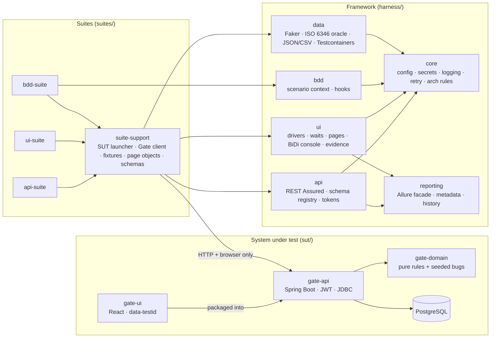

# Design decisions

Each decision states what was chosen, the alternatives considered, and why. Decisions are
numbered so code comments, commits and interviews can refer to them (`D7`).

Status legend: **Built** = implemented and exercised by tests in this repository.
**Planned** = specified for a later phase and not yet implemented.

---

## Architecture at a glance

The framework (`harness/*`) knows nothing about the Gate Appointment system. Everything
Gate-specific — the launcher, typed client, schemas, page objects — lives in
`suites/suite-support`. That boundary is what lets the Phase 4 PortSync adapter reuse the
framework unchanged.

---

## SUT

### D1 — Bundle a realistic SUT with deliberately switchable defects — Built
- **Chosen:** a small Gate Appointment system (Spring Boot 3.5 API, PostgreSQL, React UI)
  with six documented seeded defects, switchable at runtime through a test-support API.
- **Alternatives:** test a public demo site (e.g. a shop demo); test only mocks.
- **Why:** a demo site can't be broken on purpose, so it can never prove a suite *catches*
  anything. Owning the SUT makes the fault-seeding experiment (Phase 3) possible: switch a
  bug on, run everything, record who noticed.
- **Trade-off:** more code to own; the SUT is deliberately small.

### D2 — Seeded bugs are branches beside the correct code, not separate builds — Built
- **Chosen:** each defect is an `if (bugs.isEnabled(X))` branch next to the correct line
  (`CapacityPolicy`, `ContainerNumber`, `SlotTimes`, `BookingAccessPolicy`,
  `BookingService`). `MutableBugSwitches` swaps an immutable `EnumSet` atomically.
- **Alternatives:** git branches per bug; bytecode mutants; feature-flag service.
- **Why:** one binary, toggled per run without redeploying, so the experiment is cheap to
  repeat. Every bug is unit-tested in both states (`*Test` in `gate-domain`).
- **Trade-off:** the defects are visible in the source; they are documented as such.

### D3 — Plain JDBC with an explicit row lock instead of JPA — Built
- **Chosen:** `JdbcClient` with hand-written SQL; capacity checks take
  `SELECT … FOR UPDATE` on the slot row before counting and inserting.
- **Alternatives:** JPA with `@Version` optimistic locking; a stored counter column.
- **Why:** the race on the last place is one of the seeded bugs, so the concurrency control
  must be explicit and readable. Occupancy is *derived* (`count(*)` of BOOKED/CHECKED_IN
  rows) so there is no counter to drift. Proven by `GateApiIntegrationTest`: 8 concurrent
  drivers, capacity 1 → exactly 1 succeeds; with `RACE_ON_LAST_SLOT` → more than 1.
- **Trade-off:** more SQL to maintain than JPA; acceptable at this size.

### D4 — RFC 9457 problems with a stable machine-readable `code` — Built
- **Chosen:** every error is `application/problem+json` with `code` (see `docs/errors.md`).
- **Alternatives:** status codes only; free-text messages.
- **Why:** tests assert on `code`, so messages can change without breaking tests, and two
  different 409s (`SLOT_FULL` vs `DUPLICATE_ACTIVE_BOOKING`) are distinguishable.
- **Evidence it matters:** the strict schema check (D10) found that Spring's built-in
  problem-details advice pre-empted the app's handler for 14 kinds of 4xx and dropped
  `code`. Fixed in commit `9cc795c`.

### D5 — Object-level authorisation answers 404, not 403 — Built
- **Chosen:** a driver requesting another driver's booking gets `404 NOT_FOUND`.
- **Why:** 403 would confirm the reference exists (an enumeration aid). Tests assert the
  404 for read, reschedule and cancel (IDOR cases).

### D6 — A keyed, off-by-default test-support API — Built
- **Chosen:** `/api/test-support/*` (bug switches, clock offset, throw-away users) exists
  only when `gate.test-support.enabled=true` (404 otherwise) and requires
  `X-Test-Support-Key` (constant-time comparison). Compose binds ports to `127.0.0.1`.
- **Alternatives:** direct DB writes from tests; a separate admin service.
- **Why:** tests need per-test users and time travel without coupling to the schema.

### D7 — Time travel through a shiftable clock, used only in `@Isolated` tests — Built
- **Chosen:** the app's `Clock` bean is a `ShiftableClock`; tests that need "the slot
  ended 31 minutes ago" shift it via the test-support API inside an `@Isolated` class
  (JUnit runs it alone), and reset it in `@AfterEach`.
- **Alternatives:** sleeping until the time passes (forbidden, see D12); per-request clock
  headers.
- **Why:** check-in "too late" and "booking a started slot" are otherwise untestable.
  Tokens use wall-clock time so time travel cannot expire a test's session.

---

## Framework

### D8 — Layered configuration with recorded origins; secrets only from env vars — Built
- **Chosen:** `harness-defaults.yml` (framework) → `harness.yml` (project) →
  `harness-<env>.yml` (`local`/`docker`/`ci`) → `HARNESS_*` env vars → `-Dharness.*`.
  `HarnessConfig.origin(key)` says which layer won. `secret(NAME, localFallback)` reads only
  the environment; in `ci` a missing secret is an error, never a fallback.
  `Secret.toString()` is `NAME=****`.
- **Alternatives:** Spring profiles inside tests; Typesafe Config; a single properties file.
- **Why:** no framework dependency for config, explicit precedence, and a missing CI secret
  fails loudly instead of silently using a dev default.

### D9 — The SUT is booted in-process for local/CI runs, external for Docker — Built
- **Chosen:** `GateSut` (in `suite-support`) starts PostgreSQL in Testcontainers and the
  Spring Boot app in the test JVM on a random port (`sut.mode=embedded`); with
  `HARNESS_ENV=docker` it targets `http://localhost:8080` instead. Tests still use only
  HTTP and a real browser.
- **Alternatives:** always Docker Compose; a Spring `@SpringBootTest` per suite.
- **Why:** one command (`mvnw verify`) needs no Compose; start-up is ~10 s; and because the
  SUT runs in the test JVM, JaCoCo can attribute SUT lines to individual tests — the basis
  for Phase 3 test-impact analysis. The Compose path is exercised in CI (`compose-smoke`).
- **Bug found while building it:** `SpringApplicationBuilder.properties()` only sets
  lowest-precedence defaults, so `application.yml` won and the app tried `localhost:5432`.
  Settings are now passed as command-line arguments; a failed start is remembered so later
  tests fail fast with the original cause (commit `c0598f1`).

### D10 — Every response is validated against a JSON Schema — Built
- **Chosen:** a REST Assured filter validates each response against the schema registered
  for its `method + path + status` in `schemas/registry.yml` (draft 2020-12, format
  assertions on, `$ref` across files via `classpath:` URIs, using networknt
  json-schema-validator). In `strict` mode an unregistered operation fails the test.
  Catch-all rules (`* ** 4xx`) make every error on every path a problem document.
- **Alternatives:** REST Assured's own `json-schema-validator` (draft-04 only); asserting
  fields by hand per test.
- **Why:** contracts are checked uniformly, even by tests that are "about" something else.
  A violation is an `AssertionError` (a *failed* test — a product/contract defect — not a
  *broken* one).

### D11 — Independent test oracles — Built
- **Chosen:** `harness-data`'s ISO 6346 generator/validator uses the standard's letter
  table verbatim; it shares no code with the SUT's `ContainerNumber`.
- **Why:** if tests reused the SUT's check-digit code, a defect there (seeded bug
  `CHECK_DIGIT_EDGE_CASE`) would be reproduced by the tests and never detected.

### D12 — Explicit waits only, enforced by architecture tests — Built
- **Chosen:** `Waits` wraps `WebDriverWait` with a described condition for every wait;
  implicit waits are forced to zero by `DriverFactory`. ArchUnit rules
  (`HarnessArchRules`) fail the build on `Thread.sleep`, `TimeUnit.sleep`, `System.out/err`,
  and on `LockSupport.park*` anywhere except `core.retry.Pause` — the one audited place that
  blocks, used only for retry back-off and condition polling. `ArchRulesSelfTest` proves each
  rule fires on a deliberately bad class.
- **Why:** fixed sleeps are the commonest cause of slow, flaky UI suites.

### D13 — Retry is for infrastructure, never for assertions — Built
- **Chosen:** `Retry` requires an explicit attempt cap (1–10) and an explicit predicate of
  retryable failures; everything else fails immediately. There is no "retry failed test".
- **Why:** retrying assertions hides flakiness. Phase 3 measures and quarantines flaky
  tests instead.

### D14 — One browser per thread, data isolation per test — Built
- **Chosen:** `Drivers` holds a `ThreadLocal` session; JUnit 5 runs classes and methods
  concurrently (4 workers API, 2 UI locally, overridable). Each test creates its own users
  (test-support API) and slots in a lane nobody else uses (`UniqueIds`), so tests never
  share rows. Tests that change global state are `@Isolated`.
- **Alternatives:** reset the database between tests; serial UI tests.
- **Why:** parallel-safe by construction rather than by luck; no global teardown needed.
  Fixed-value data (e.g. the ISO worked example `CSQU3054383`) is cancelled after use so
  runs against a persistent Compose database stay repeatable.

### D15 — Cross-browser console capture over WebDriver BiDi — Built
- **Chosen:** every driver is created with `webSocketUrl=true`; `BrowserConsole` subscribes
  to console entries and uncaught JS errors via `LogInspector`.
- **Alternatives:** Chrome `goog:loggingPrefs` (Chrome/Edge only).
- **Why:** identical evidence in Chrome, Firefox and Edge. Verified in Chrome 154 and
  Firefox 157 by `RealBrowserTest`. If BiDi is unavailable the report says so instead of
  showing an empty log.

### D16 — Evidence is captured before the browser closes — Built
- **Chosen:** `BrowserExtension` captures screenshot, page HTML, URL and console in
  `afterTestExecution` (before `afterEach` quits the browser), attaches them to Allure and
  writes them under `target/evidence/<test>/`. Capture errors are logged, never thrown, so
  they cannot mask the real failure.

### D17 — UI journeys sign in through an API token — Built
- **Chosen:** apart from the login tests themselves, journeys put a token from the API into
  `sessionStorage` and start on the page under test.
- **Why:** a broken login form then fails the login tests only (clear signal) and the UI
  suite is faster.

### D18 — Native date inputs are set through the value setter, then verified — Built
- **Chosen:** `Inputs.setDate` uses the native `HTMLInputElement.value` setter and
  dispatches `input`/`change` (what React listens for), then asserts the value took.
- **Why:** typing into `<input type="date">` depends on the browser's locale order. This is
  the one place the framework uses JavaScript to drive the page; it is documented as such.

### D19 — Page objects + components scoped to a root — Built
- **Chosen:** `BasePage` (knows its ready-locator and path) and `Component` (all lookups
  scoped to a root). `SlotPicker` is one class used for both the booking form and the
  reschedule panel, selected by a `data-testid` prefix.

### D20 — Allure as the single report, generated through its Java entry point — Built
- **Chosen:** all suites write to `target/allure-results`; `mvnw -N -Preport verify`
  unpacks the Allure CLI from the Maven repository and runs `io.qameta.allure.CommandLine`
  with `java`, then saves `history/` for trend charts.
  `categories.json` buckets failures as locator / timeout / environment / schema /
  assertion / unexpected exception.
- **Alternatives:** `allure-maven`'s `report` goal (a Maven *site* report — needs a site
  skin and failed offline); shelling out to `bin/allure` (differs on Windows).

### D21 — Cucumber state through PicoContainer and a typed context — Built
- **Chosen:** `ScenarioContext` with typed keys (`Key.of("booking reference", String.class)`)
  injected per scenario; a missing value says which Given step is probably missing. A
  `{time}` parameter type turns `09:30` into a `LocalTime`.

---

## Build and tooling

### D22 — Version lines follow the brief, at their latest patch — Built
Spring Boot **3.5.16**, JUnit **5.14.4**, Cucumber **7.34.9**, Selenium **4.51.0**,
REST Assured **5.5.7**, Testcontainers **1.21.4**, Allure **2.35.5** (CLI 2.46.1).
Newer majors exist (Spring Boot 4, JUnit 6, Cucumber 8 — probed 2026-10-14 by
`bootstrap-probe.yml`); the brief named the 3/5/7 lines, so their newest patches were
pinned. Our BOMs are imported before Spring Boot's so the test stack is not downgraded.

### D23 — Selenium Manager instead of WebDriverManager — Built
Selenium 4 resolves drivers itself. `ui.binary.<browser>` and `ui.driver-path.<browser>`
exist for machines where downloads are blocked.

### D24 — Maven Wrapper (script-only) and pinned lifecycle plugins — Built
The wrapper was generated by CI (Maven Central is not reachable from the authoring
sandbox). Lifecycle plugins (clean, resources, install, …) are pinned because Maven 3.9 and
3.10 default to different versions.

---

## Known limits (honest list)
- Edge has not been run outside CI (no Edge binary in the authoring sandbox).
- The race-condition bug uses a configurable pause (`gate.race-window`, 150 ms) to make the
  race reproducible on any machine; without it the race is real but intermittent.
- Coverage numbers in RESULTS.md are per-module unit/integration coverage; per-test
  coverage of the SUT during suite runs arrives with Phase 3 test-impact analysis.
