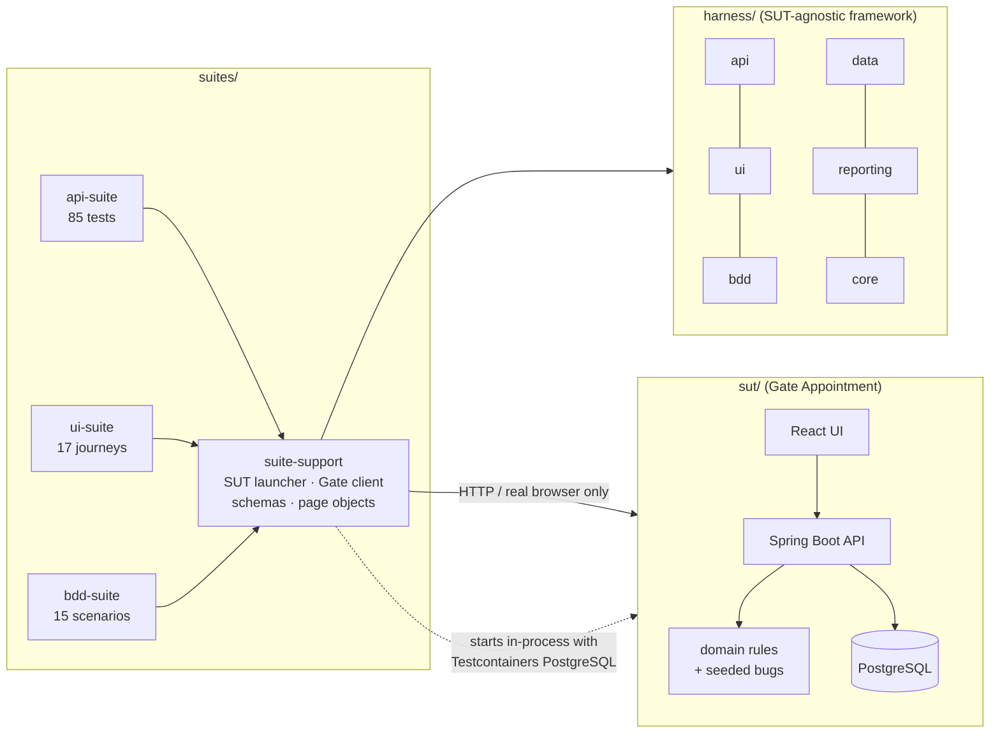

# TestHarness

**A test automation framework that proves its own value.** TestHarness ships with a
realistic system under test — a container-terminal *Gate Appointment* app — that contains
six documented, switchable defects. The framework's API, UI and BDD suites run against it
in one command, and (from Phase 3) a fault-seeding experiment measures which suite catches
which defect.

Java 21 · Selenium 4 · REST Assured · Cucumber 7 · JUnit 5 (parallel) · AssertJ ·
Testcontainers · Allure · Spring Boot 3 · PostgreSQL · React · GitHub Actions

[](https://github.com/RaktimChandra/TestHarness/actions/workflows/ci.yml)

---

## Results (measured)

From a clean `verify` on 2026-10-14 — method, machine and per-module timings are in
[RESULTS.md](RESULTS.md). Nothing in this table is estimated.

| | |
|---|---|
| Tests in one `verify` | **348 JVM tests + 22 Vitest**, 0 failed |
| Wall-clock, clean build + all suites (2 vCPU sandbox, headless Chrome) | **3 min 59 s** |
| API suite | 85 tests — every endpoint, auth, authorisation (IDOR), boundaries, concurrency |
| UI suite | 17 journeys — passing in Chrome 154 and Firefox 157 (Edge: CI) |
| BDD suite | 15 scenarios (13 API-level, 2 in a real browser) |
| Real defects the suites found in the SUT while being built | 1 — 14 kinds of 4xx responses missing the error `code` (commit `9cc795c`) |
| Domain rules coverage (own unit tests) | 98.4 % lines · 100 % branches |

## What makes it different

- **A SUT you can break on purpose.** Six seeded bugs (off-by-one capacity, ISO 6346
  check-digit edge case, timezone shift, race on the last place, missing authorisation,
  UI-only validation) are runtime switches beside the correct code — the basis for
  measuring defect detection rather than claiming it.
- **Contract checks on every response.** A REST Assured filter validates each response
  against a JSON Schema (draft 2020-12, formats asserted). Unregistered endpoints fail in
  strict mode, and every error on every path must be an RFC 9457 problem with a stable code.
- **Concurrency tested for real.** Six drivers race for one place over HTTP; exactly one
  wins. With the race bug switched on, more than one does (`GateApiIntegrationTest`).
- **Parallel by construction.** One browser per thread, and every test creates its own users
  and its own lane of slots, so nothing is shared between tests.
- **No sleeps, enforced.** ArchUnit fails the build on `Thread.sleep`; waits are explicit and
  describe what they waited for. Retries exist only for infrastructure and are bounded.
- **Evidence for every failure.** Screenshot, page HTML, URL and browser console (WebDriver
  BiDi, so the same in Chrome, Firefox and Edge), plus request/response bodies.
- **Independent oracles.** The test-side ISO 6346 validator shares no code with the SUT, so
  a check-digit bug can't be reproduced by the tests meant to catch it.
- **Honest config.** Secrets come only from environment variables; in CI there is no
  fallback — the first pipeline run failed precisely because one was missing.

## Architecture



Design decisions and trade-offs: [DESIGN.md](DESIGN.md) · Test pyramid and what each
suite proves: [TEST_STRATEGY.md](TEST_STRATEGY.md) · How to write tests:
[FRAMEWORK_GUIDE.md](FRAMEWORK_GUIDE.md).

## Quick start

Prerequisites: **JDK 21**, **Docker** running, **Chrome**. No Maven or Node install needed.

```bash
./mvnw verify                      # Windows: .\mvnw.cmd verify
```

That builds the SUT and the framework, starts PostgreSQL (Testcontainers) and the app, and
runs the unit, framework, API, UI (headless Chrome) and BDD suites.

```bash
./mvnw -N -Preport verify          # render the Allure report for everything that ran
jwebserver -d "$PWD/target/allure-report" -p 8000   # then open http://localhost:8000
```

Windows, step by step and one command at a time: [docs/WINDOWS.md](docs/WINDOWS.md).

Common variations:

```bash
./mvnw verify -pl suites/api-suite -am                              # one suite
./mvnw verify -pl suites/ui-suite -am -Dharness.ui.browser=firefox  # another browser
./mvnw verify -pl suites/bdd-suite -am -Dcucumber.filter.tags=@smoke
docker compose up -d --build && HARNESS_ENV=docker ./mvnw verify -pl suites/api-suite -am
```

## The system under test

| Role | Can |
|---|---|
| Driver (`driver1`..`driver3`) | book a slot for a container (drop-off or pick-up), see own bookings, reschedule or cancel up to 1 h before the slot |
| Clerk (`clerk1`, `clerk2`) | open slots, search all bookings, check a truck in from 2 h before the slot until 30 min after it ends |

Demo password: `gate-demo-pass` (override with `GATE_SEED_PASSWORD`). Error codes:
[docs/errors.md](docs/errors.md).

| Driver: booking with live ISO 6346 check | Clerk: search and check-in |
|---|---|
|  |  |


### Seeded defects

| Bug | What goes wrong |
|---|---|
| `OFF_BY_ONE_CAPACITY` | a slot accepts capacity + 1 bookings |
| `CHECK_DIGIT_EDGE_CASE` | valid containers whose check digit comes from remainder 10 are rejected |
| `TIMEZONE_SLOT_TIMES` | slot times are relabelled instead of converted (shifted by the zone offset) |
| `RACE_ON_LAST_SLOT` | concurrent bookings for the last place all succeed (no row lock) |
| `MISSING_AUTHORISATION_CHECK` | drivers can read and change other drivers' bookings |
| `API_SKIPS_CONTAINER_VALIDATION` | the UI validates container numbers; the API doesn't |

Switch them on for a run with `-Dharness.sut.seeded-bugs=OFF_BY_ONE_CAPACITY,RACE_ON_LAST_SLOT`.

## Screenshots and GIFs for your own runs

- Every failed UI test leaves `suites/*/target/evidence/<test>/screenshot.png`,
  `page.html` and `console.log`.
- To capture a journey as a GIF: run a UI test with `-Dharness.ui.headless=false`, record
  the browser window with ScreenToGif (Windows) or Peek (Linux) and save it under
  `docs/images/`.
- The screenshots above were taken from the running app with headless Chrome.

## Roadmap

| Phase | Status |
|---|---|
| 1 — SUT, framework core, API/UI/BDD suites, CI, docs | **done** (this release) |
| 2 — Selenium Grid in Compose, visual regression, axe-core a11y, Pact, Gatling, security smoke | planned |
| 3 — fault-seeding experiment, flaky-test intelligence, honest self-healing locators, test impact analysis, PIT, AI-assisted test design | planned |
| 4 — React quality dashboard, CLI, "new test in 5 minutes" guide, PortSync adapter | planned |
| 5 — full CI/CD with quality gates, TeamCity Kotlin DSL, CIForge pipeline | planned |

Changes per phase: [CHANGELOG.md](CHANGELOG.md).

## Licence

MIT © 2026 Raktim Chandra
