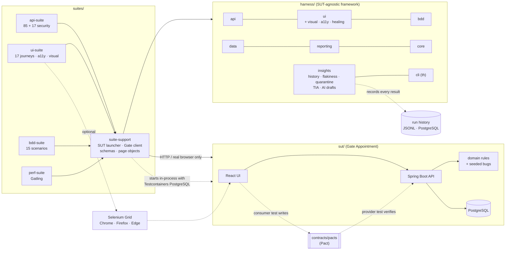
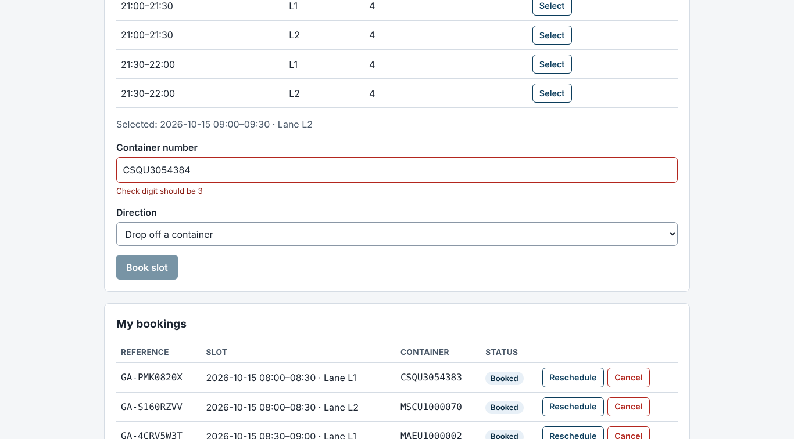
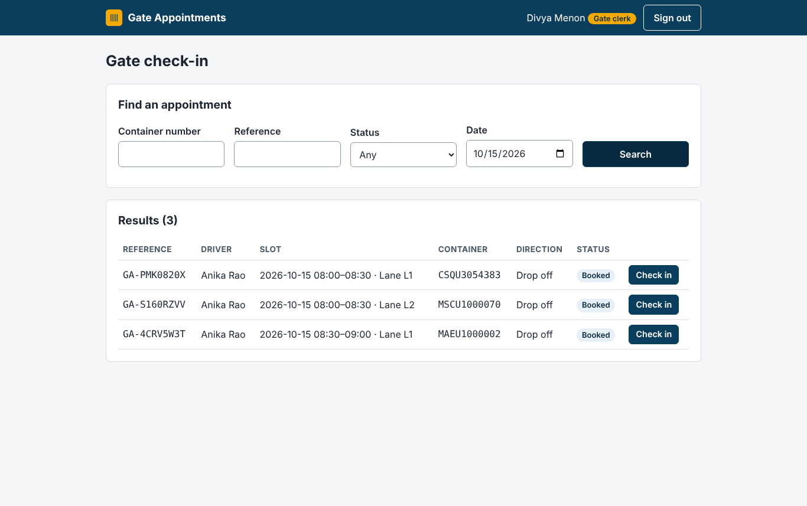
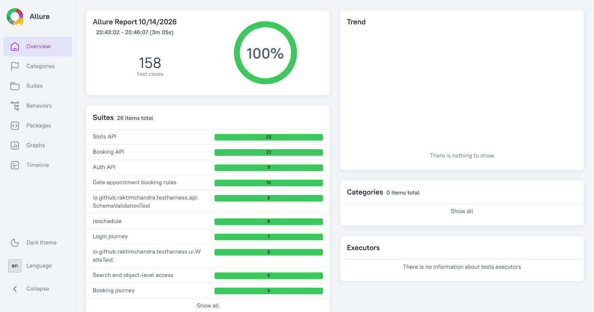

# TestHarness

**A test automation framework that proves its own value.** TestHarness ships with a
realistic system under test — a container-terminal *Gate Appointment* app — that contains
six documented, switchable defects. API, UI, BDD, contract, accessibility, visual,
security and performance tests run against it in one command, and a fault-seeding
experiment measures which suite catches which defect.

Java 21 · Selenium 4 + Grid · REST Assured · Cucumber 7 · JUnit 5 (parallel) · AssertJ ·
Testcontainers · Allure · axe-core · Pact · Gatling · Spring Boot 3 · PostgreSQL · React ·
GitHub Actions

[](https://github.com/RaktimChandra/TestHarness/actions/workflows/ci.yml)

---

## Results (measured)

From real runs on 2026-10-14 and 2026-10-15 — method, machine and raw numbers for every row are in
[RESULTS.md](RESULTS.md). Nothing in this table is estimated.

| | |
|---|---|
| Tests in one `verify` | **458 JVM tests + 31 Vitest + 1 Gatling simulation**, 0 failed (5 visual checks skip outside CI by design) |
| Wall-clock, clean build + everything (2 vCPU sandbox) | **5 min 51 s** |
| Fault seeding: 6 bugs × 8 suite types (CI) | **6/6 caught** by at least one suite · API 100 % · BDD 83 % · contract, security, UI 33 % each · the race bug caught by **one test of 151** |
| Mutation score, domain rules (PIT, STRONGER) | **95.1 % → 100 %** (143 mutants) after turning the 7 survivors into tests |
| Test impact analysis, per-test JaCoCo | **6/6 seeded bugs still caught** by the selected subset; wall-clock saved **3.8–21.6 %** (and why so little) |
| Flaky-test detection (20 runs, one commit, CI) | deliberately flaky test scored **0.368** and was auto-quarantined; its stable control scored 0 |
| Self-healing locators | **1 heal in 26 UI tests** — the demo that renames a `data-testid` — reported with the exact fix, never silent |
| Cross-browser | UI suite passes in **Chrome 154, Firefox 157 and Edge 154** in CI, both directly and on **Selenium Grid** |
| Accessibility (axe-core, WCAG 2.0/2.1 A+AA) | **0 violations** on 9 page states × 3 browsers |
| Contract (Pact) | **9/9** interactions from the UI's real client verified against the real API |
| Booking flow under load (60 users, CI runner) | **p95 73 ms · p99 78 ms · 0 errors** (gates: 800 / 1500 ms / 1 %) |
| Grid scaling, 1 → 4 workers on one 4-vCPU runner | test span **−13 to −23 %**; 8 workers slower than 4 — CPU-bound, explained in RESULTS §8 |
| Real defects found while building the suites | **8** — 3 in the SUT, 5 in tests/framework/infra, each with the run or test that found it |
| Domain rules coverage (own unit tests) | 98.4 % lines · 100 % branches |

## What makes it different

- **A SUT you can break on purpose.** Six seeded bugs (off-by-one capacity, ISO 6346
  check-digit edge case, timezone shift, race on the last place, missing authorisation,
  UI-only validation) are runtime switches beside the correct code — the basis for
  measuring defect detection rather than claiming it.
- **Contract checks on every response.** A REST Assured filter validates each response
  against a JSON Schema (draft 2020-12, formats asserted). Unregistered endpoints fail in
  strict mode, and every error on every path must be an RFC 9457 problem with a stable code.
- **Concurrency tested for real.** Six drivers race for one place over HTTP; exactly one
  wins. With the race bug switched on, more than one does (`GateApiIntegrationTest`).
- **Parallel by construction.** One browser per thread, and every test creates its own users
  and its own lane of slots, so nothing is shared between tests.
- **No sleeps, enforced.** ArchUnit fails the build on `Thread.sleep`; waits are explicit and
  describe what they waited for. Retries exist only for infrastructure and are bounded.
- **Evidence for every failure.** Screenshot, page HTML, URL and browser console (WebDriver
  BiDi, so the same in Chrome, Firefox and Edge), plus request/response bodies.
- **Independent oracles.** The test-side ISO 6346 validator shares no code with the SUT, so
  a check-digit bug can't be reproduced by the tests meant to catch it.
- **Honest config.** Secrets come only from environment variables; in CI there is no
  fallback — the first pipeline run failed precisely because one was missing.
- **Contracts generated by the real client.** The Pact consumer test drives the UI's own
  API client; the contract is committed and CI fails if it drifts. Provider verification
  found a real timestamp-format bug.
- **Visual checks that don't cry wolf.** Perceptual diff, per-platform baselines rendered in
  CI and approved by merging a branch, and page stabilisation — the two flaky causes found
  (focus rings, neighbouring data) were diagnosed and fixed, not hidden behind a tolerance.
- **Accessibility on every state.** axe-core scans dialogs, errors and panels, not just
  landing pages, and the build fails on critical or serious violations.
- **Defect detection measured per suite.** Each seeded bug is switched on in CI and every
  suite type runs against it; a suite gets credit only if it was green without the bug.
  The result included a strategy mistake (Pact was expected to catch the timezone bug; it
  can't) — kept in the docs, not hidden.
- **Flakiness from history, not from retries.** Every result goes to JSON Lines and
  optionally PostgreSQL; a test that flips on the *same commit* is scored, classified
  (locator / timeout / assertion / environment / data) and quarantined into a non-blocking
  job by a JUnit discovery filter — no `@Disabled` edits, no retry-until-green.
- **Self-healing that tells on itself.** Ranked fallbacks (test id, id, accessible name, text,
  position); a healed step is labelled `healed` in Allure with the exact fix, ambiguous
  matches are never used, and a CI mode turns any heal into a failure.
- **Test impact analysis with its limits measured.** Per-test JaCoCo coverage of the SUT
  maps tests to files; selecting from a diff caught every seeded bug but saved far less
  time than vendors suggest, and RESULTS says why.
- **AI as a drafting tool, never a committer.** Any OpenAI-compatible or Anthropic endpoint
  via an API key; drafts Gherkin from a user story (parsed, banner-marked, `@draft`, written
  outside the source tree) and summarises failed runs. Everything works without it.
- **One CLI.** `./th run --suite ui --browser firefox --tags smoke`, `./th rerun-failed`,
  `./th report`, `./th history flaky`, `./th tia select`, `./th ai gherkin`.
- **Measured, not claimed, parallel speed-up.** Grid timings at 1/4/8 workers with test
  span and per-test time separated — including the result that more workers made it slower.

## Architecture



Design decisions and trade-offs: [DESIGN.md](DESIGN.md) · Test pyramid and what each
suite proves: [TEST_STRATEGY.md](TEST_STRATEGY.md) · How to write tests:
[FRAMEWORK_GUIDE.md](FRAMEWORK_GUIDE.md).

## Quick start

Prerequisites: **JDK 21**, **Docker** running, **Chrome**. No Maven or Node install needed.

```bash
./mvnw verify                      # Windows: .\mvnw.cmd verify
```

That builds the SUT and the framework, starts PostgreSQL (Testcontainers) and the app, and
runs the unit, framework, contract, API + security, UI (headless Chrome, with
accessibility and visual checks), BDD and Gatling suites.

```bash
./mvnw -N -Preport verify          # render the Allure report for everything that ran
jwebserver -d "$PWD/target/allure-report" -p 8000   # then open http://localhost:8000
```

Or through the `th` command (Windows: `th.cmd`), after `./mvnw install -DskipTests` once:

```bash
./th run --suite api                      # one suite (api | ui | bdd | perf | all)
./th run --suite ui --browser firefox --tags smoke
./th rerun-failed                         # only what failed last time, per module
./th report                               # generate + open the Allure report
./th history flaky --jsonl suites         # flakiness leaderboard from recorded history
./th --help                               # everything else (tia, ai, history quarantine)
```

Windows, step by step and one command at a time: [docs/WINDOWS.md](docs/WINDOWS.md).

Common variations:

```bash
./mvnw verify -pl suites/api-suite -am                              # one suite
./mvnw verify -pl suites/ui-suite -am -Dharness.ui.browser=firefox  # another browser
./mvnw verify -pl suites/bdd-suite -am -Dcucumber.filter.tags=@smoke
docker compose up -d --build && HARNESS_ENV=docker ./mvnw verify -pl suites/api-suite -am
./mvnw verify -pl suites/perf-suite -am -Dperf.users=200      # heavier load test
./mvnw verify -DskipPerf                                       # everything except Gatling
```

On Selenium Grid (hub + Chrome/Firefox/Edge nodes in Docker):

```bash
docker compose -f docker-compose.yml -f docker-compose.grid.yml up -d --build --wait
HARNESS_ENV=docker ./mvnw verify -pl suites/ui-suite -am -Dharness.ui.grid-url=http://localhost:4444 \
  -Dharness.sut.browser-base-url=http://gate:8080 -Dharness.ui.browser=edge -DexcludedGroups=visual
```

## The system under test

| Role | Can |
|---|---|
| Driver (`driver1`..`driver3`) | book a slot for a container (drop-off or pick-up), see own bookings, reschedule or cancel up to 1 h before the slot |
| Clerk (`clerk1`, `clerk2`) | open slots, search all bookings, check a truck in from 2 h before the slot until 30 min after it ends |

Demo password: `gate-demo-pass` (override with `GATE_SEED_PASSWORD`). Error codes:
[docs/errors.md](docs/errors.md).

| Driver: booking with live ISO 6346 check | Clerk: search and check-in |
|---|---|
|  |  |



### Seeded defects

| Bug | What goes wrong |
|---|---|
| `OFF_BY_ONE_CAPACITY` | a slot accepts capacity + 1 bookings |
| `CHECK_DIGIT_EDGE_CASE` | valid containers whose check digit comes from remainder 10 are rejected |
| `TIMEZONE_SLOT_TIMES` | slot times are relabelled instead of converted (shifted by the zone offset) |
| `RACE_ON_LAST_SLOT` | concurrent bookings for the last place all succeed (no row lock) |
| `MISSING_AUTHORISATION_CHECK` | drivers can read and change other drivers' bookings |
| `API_SKIPS_CONTAINER_VALIDATION` | the UI validates container numbers; the API doesn't |

Switch them on for a run with `-Dharness.sut.seeded-bugs=OFF_BY_ONE_CAPACITY,RACE_ON_LAST_SLOT`.

## Screenshots and GIFs for your own runs

- Every failed UI test leaves `suites/*/target/evidence/<test>/screenshot.png`,
  `page.html` and `console.log`; a failed visual check also leaves
  `target/visual/diff/<platform>/<name>-actual.png` and `-diff.png`.
- To capture a journey as a GIF: run a UI test with `-Dharness.ui.headless=false`, record
  the browser window with ScreenToGif (Windows) or Peek (Linux) and save it under
  `docs/images/`.
- The screenshots above were taken from the running app with headless Chrome.

## Roadmap

| Phase | Status |
|---|---|
| 1 — SUT, framework core, API/UI/BDD suites, CI, docs | **done** |
| 2 — Selenium Grid in Compose, visual regression, axe-core a11y, Pact, Gatling, security smoke | **done** |
| 3 — fault-seeding experiment, flaky-test intelligence, honest self-healing locators, test impact analysis, PIT, AI-assisted test design | **done** (this release) |
| 4 — React quality dashboard, CLI, "new test in 5 minutes" guide, PortSync adapter | planned |
| 5 — full CI/CD with quality gates, TeamCity Kotlin DSL, CIForge pipeline | planned |

Changes per phase: [CHANGELOG.md](CHANGELOG.md).

## Licence

MIT © 2026 Raktim Chandra
