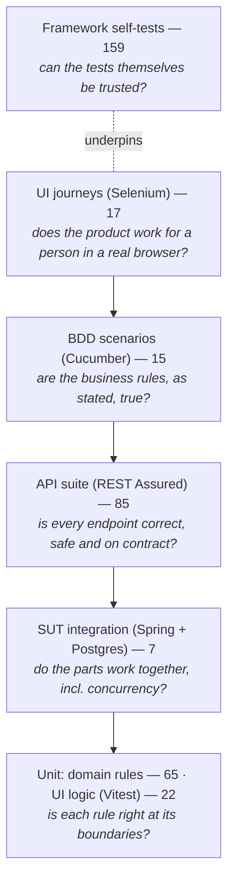

# Test strategy

What each layer of tests exists for, what it proves, and what it deliberately does not try
to prove. Counts are from the run recorded in [RESULTS.md](RESULTS.md).

## The pyramid

The shape is deliberate: most checks sit where they are cheapest and most precise
(milliseconds, exact failure location); each layer above adds only what the layer below
**cannot** see.

| Layer | What only this layer can catch | What it does *not* try to do |
|---|---|---|
| **Domain unit tests** (`gate-domain`) | Off-by-one at capacity boundaries, the ISO 6346 remainder-10 case, time-window edges to the second, status-machine transitions — each seeded bug in both its correct and broken state | Anything involving HTTP, SQL, security or the browser |
| **UI unit tests** (Vitest, `gate-ui`) | Client-side ISO 6346 validation, wall-clock time formatting, API-client URL encoding and error mapping | Rendering in real browsers |
| **SUT integration** (`gate-api`) | That the row lock really serialises concurrent bookings, that Flyway + security + JSON wiring work together | Black-box behaviour (that's the suites' job) |
| **API suite** | Every endpoint × positive/negative/boundary/auth/authorisation; contract (schema) on every response; IDOR; injection payloads as plain values; concurrency at the HTTP boundary | Visual or usability problems |
| **BDD suite** | That the rules a business person would state ("a slot can't take more trucks than its capacity") hold, in their words; living documentation | Exhaustive combinations (the API suite does that) |
| **UI journeys** | The product works end-to-end for a person: wiring between React and the API, what the user is *shown* (e.g. the slot time), client-side validation, confirmation dialogs | Re-testing every rule through the browser (slow; already covered below) |
| **Framework self-tests** | Wait timeouts are descriptive, schema violations are caught, config precedence is right, secrets never print, retries are bounded, arch rules fire | — |

## What each suite proves

### API suite — 85 tests (`suites/api-suite`)
- **Auth:** seeded users log in; wrong password and unknown user give the *same* 401
  (no username enumeration); blank/malformed bodies → 400 with per-field errors; missing,
  garbage and **tampered** tokens → 401; `me` returns the caller.
- **Slots:** capacity boundaries `0/1/50/51/-1`, length boundaries `4/5/240/241` minutes,
  past start, duplicate lane+time, required fields, lane format, role (driver 403,
  anonymous 401), unknown/bad ids, live `booked`/`remaining`; times are the terminal's wall
  clock with its offset, including when requested in UTC.
- **Bookings:** data-driven ISO 6346 cases from `data/container-cases.json` (incl.
  remainder-10, lower case, whitespace, Arabic-Indic digits, blank); capacity boundary;
  **six concurrent drivers race for the last place → exactly one wins**; one open booking
  per container; re-booking after cancel; required fields / bad enum; unknown slot; role
  checks; case-insensitive references.
- **Lifecycle:** reschedule (moves + both slots updated, same slot, full slot, unknown slot,
  inside the 1-hour cut-off, after cancel, another driver = 404, clerk = 403); cancel
  (frees the place, twice, other driver, cut-off, clerk); check-in (inside window, too
  early, twice, after cancel, driver forbidden, unknown).
- **Search/access:** drivers only ever see their own bookings (also via filters); clerks see
  all; combined filters; invalid filter values; SQL-injection payloads return nothing and
  break nothing.
- **Time-dependent (`@Isolated`):** check-in too late, booking a started slot, clock
  endpoint, test-support key enforcement, seeded-bug switches round-trip.

### UI suite — 17 journeys (`suites/ui-suite`)
Login (driver/clerk landing, wrong password, disabled submit, deep link redirect, role
redirect, sign-out); booking (happy path incl. the time shown, live remaining places, full
slot not selectable, invalid check digit explained, remainder-10 accepted end-to-end,
server rejection shown); reschedule; cancel with confirm/keep; clerk check-in and too-early
message.

### BDD suite — 15 scenarios (`suites/bdd-suite`)
`booking_rules.feature` (capacity, ISO 6346 outline, one open booking per container,
privacy between drivers, cancel releases the place, 1-hour cut-off) and
`gate_checkin.feature` (window, too early, drivers can't check in, two `@ui` journeys).
Tags: `@smoke`, `@regression`, `@api`, `@ui`.

## Seeded defects and which layer is expected to catch them

These are **expectations**, written before the Phase 3 experiment measures the real
detection matrix. They are listed here so the experiment can show where the strategy was
right or wrong.

| Seeded bug | Expected to be caught by |
|---|---|
| `OFF_BY_ONE_CAPACITY` | domain unit, API (capacity boundary, race), BDD (capacity scenario) |
| `CHECK_DIGIT_EDGE_CASE` | domain unit, API (remainder-10 data cases), BDD (outline row `MSCU1000110`), UI (remainder-10 journey) |
| `TIMEZONE_SLOT_TIMES` | domain unit, API (terminal wall-clock assertions), UI (time shown), BDD `@ui` (time shown) |
| `RACE_ON_LAST_SLOT` | SUT integration, API (6-way race) — not UI/BDD (no concurrency there) |
| `MISSING_AUTHORISATION_CHECK` | domain unit, API (IDOR read/reschedule/cancel, search privacy), BDD (privacy scenario) |
| `API_SKIPS_CONTAINER_VALIDATION` | API (invalid check digit/category/length → 400), BDD outline — **not** UI (the UI validates client-side, which is exactly why the bug hides from UI testing) |

## Principles applied everywhere
- **Isolation by data, not by teardown:** each test makes its own users and its own lane.
- **No fixed sleeps:** explicit waits only (enforced by ArchUnit).
- **No silent retries of assertions:** flakiness is measured (Phase 3), not hidden.
- **Contract on every response:** strict schema validation, including every error.
- **Independent oracles:** test-side ISO 6346 shares no code with the SUT.
- **Evidence on failure:** screenshot, HTML, URL, browser console, request/response bodies.
