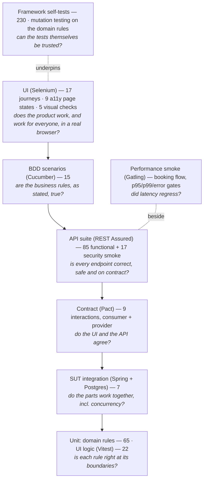

# Test strategy

What each layer of tests exists for, what it proves, and what it deliberately does not try
to prove. Counts are from the run recorded in [RESULTS.md](RESULTS.md).

## The pyramid

The shape is deliberate: most checks sit where they are cheapest and most precise
(milliseconds, exact failure location); each layer above adds only what the layer below
**cannot** see.

| Layer | What only this layer can catch | What it does *not* try to do |
|---|---|---|
| **Domain unit tests** (`gate-domain`) | Off-by-one at capacity boundaries, the ISO 6346 remainder-10 case, time-window edges to the second, status-machine transitions — each seeded bug in both its correct and broken state | Anything involving HTTP, SQL, security or the browser |
| **UI unit tests** (Vitest, `gate-ui`) | Client-side ISO 6346 validation, wall-clock time formatting, API-client URL encoding and error mapping | Rendering in real browsers |
| **SUT integration** (`gate-api`) | That the row lock really serialises concurrent bookings, that Flyway + security + JSON wiring work together | Black-box behaviour (that's the suites' job) |
| **API suite** | Every endpoint × positive/negative/boundary/auth/authorisation; contract (schema) on every response; IDOR; injection payloads as plain values; concurrency at the HTTP boundary | Visual or usability problems |
| **BDD suite** | That the rules a business person would state ("a slot can't take more trucks than its capacity") hold, in their words; living documentation | Exhaustive combinations (the API suite does that) |
| **UI journeys** | The product works end-to-end for a person: wiring between React and the API, what the user is *shown* (e.g. the slot time), client-side validation, confirmation dialogs | Re-testing every rule through the browser (slow; already covered below) |
| **Contract tests** (Pact) | The UI's real API client and the API disagree on a field, status or format — before either is deployed | Behaviour beyond what the UI uses |
| **Accessibility** (axe-core) | WCAG 2.0/2.1 A/AA rule violations on every page *state* (dialogs, errors, panels) | Screen-reader or keyboard-only usability (manual) |
| **Visual regression** | Layout, colour and styling changes nobody asserted on | Behaviour; focus styling (stabilised away, DESIGN D26) |
| **Security smoke** | Auth bypass, IDOR, mass assignment, injection handling, header and error hygiene | Being a penetration test |
| **Performance smoke** (Gatling) | Latency or error-rate regressions in the booking flow under 60 concurrent users | Production capacity (shared runner) |
| **Framework self-tests** | Wait timeouts are descriptive, schema violations are caught, config precedence is right, secrets never print, retries are bounded, arch rules fire, the visual diff and axe gate catch known faults | — |

## What each suite proves

### API suite — 102 tests (`suites/api-suite`): 85 functional + 17 security
- **Auth:** seeded users log in; wrong password and unknown user give the *same* 401
  (no username enumeration); blank/malformed bodies → 400 with per-field errors; missing,
  garbage and **tampered** tokens → 401; `me` returns the caller.
- **Slots:** capacity boundaries `0/1/50/51/-1`, length boundaries `4/5/240/241` minutes,
  past start, duplicate lane+time, required fields, lane format, role (driver 403,
  anonymous 401), unknown/bad ids, live `booked`/`remaining`; times are the terminal's wall
  clock with its offset, including when requested in UTC.
- **Bookings:** data-driven ISO 6346 cases from `data/container-cases.json` (incl.
  remainder-10, lower case, whitespace, Arabic-Indic digits, blank); capacity boundary;
  **six concurrent drivers race for the last place → exactly one wins**; one open booking
  per container; re-booking after cancel; required fields / bad enum; unknown slot; role
  checks; case-insensitive references.
- **Lifecycle:** reschedule (moves + both slots updated, same slot, full slot, unknown slot,
  inside the 1-hour cut-off, after cancel, another driver = 404, clerk = 403); cancel
  (frees the place, twice, other driver, cut-off, clerk); check-in (inside window, too
  early, twice, after cancel, driver forbidden, unknown).
- **Search/access:** drivers only ever see their own bookings (also via filters); clerks see
  all; combined filters; invalid filter values; SQL-injection payloads return nothing and
  break nothing.
- **Time-dependent (`@Isolated`):** check-in too late, booking a started slot, clock
  endpoint, test-support key enforcement, seeded-bug switches round-trip.
- **Security smoke (`@Tag("security")`, 17):** `alg=none` and foreign-key JWTs; wrong
  schemes and empty tokens; cross-driver read/move/cancel; driver use of clerk
  operations; mass assignment of status/owner ignored; hostile references (traversal,
  encoded slashes, SQL) are plain 404/400 problems; SQL injection in login fails closed;
  script payloads rejected and never reflected; security headers; no stack traces in
  errors; test-support API unreachable without its key.

### UI suite — 25 tests (`suites/ui-suite`): 17 journeys, 3 accessibility, 5 visual
Login (driver/clerk landing, wrong password, disabled submit, deep link redirect, role
redirect, sign-out); booking (happy path incl. the time shown, live remaining places, full
slot not selectable, invalid check digit explained, remainder-10 accepted end-to-end,
server rejection shown); reschedule; cancel with confirm/keep; clerk check-in and too-early
message.

**Accessibility (`@Tag("a11y")`):** three tests drive the app through nine states — login,
login error, driver page, validation error, reschedule panel, cancel dialog, clerk page,
search results, checked-in notice — and scan each with axe-core; any critical or serious
WCAG A/AA violation fails the build.

**Visual (`@Tag("visual")`):** login form, login error, booking form with a check-digit
error, cancel dialog, clerk search form — each compared with its per-browser CI baseline,
dynamic text masked.

### Contract — 9 interactions (`sut/gate-ui` consumer, `sut/gate-api` provider)
Login ok/401, list slots, book, slot full (409), list bookings, reschedule, cancel,
check-in. The consumer side runs the UI's real client; the provider side runs the real app
against PostgreSQL with provider states.

### Performance — `suites/perf-suite`
One Gatling simulation of the driver flow (5 requests per user, 60 users over 30 s by
default) with gates p95 < 800 ms, p99 < 1500 ms, errors < 1 %.

### BDD suite — 15 scenarios (`suites/bdd-suite`)
`booking_rules.feature` (capacity, ISO 6346 outline, one open booking per container,
privacy between drivers, cancel releases the place, 1-hour cut-off) and
`gate_checkin.feature` (window, too early, drivers can't check in, two `@ui` journeys).
Tags: `@smoke`, `@regression`, `@api`, `@ui`.

## Seeded defects and which layer is expected to catch them

These are **expectations**, written before the Phase 3 experiment measures the real
detection matrix. They are listed here so the experiment can show where the strategy was
right or wrong.

| Seeded bug | Expected to be caught by |
|---|---|
| `OFF_BY_ONE_CAPACITY` | domain unit, API (capacity boundary, race), BDD (capacity scenario) |
| `CHECK_DIGIT_EDGE_CASE` | domain unit, API (remainder-10 data cases), BDD (outline row `MSCU1000110`), UI (remainder-10 journey) |
| `TIMEZONE_SLOT_TIMES` | domain unit, API (terminal wall-clock assertions), UI (time shown), BDD `@ui` (time shown), Pact provider (fixed slot times in the contract) |
| `RACE_ON_LAST_SLOT` | SUT integration, API (6-way race) — not UI/BDD (no concurrency there) |
| `MISSING_AUTHORISATION_CHECK` | domain unit, API (IDOR read/reschedule/cancel, search privacy), security smoke (cross-driver access), BDD (privacy scenario) |
| `API_SKIPS_CONTAINER_VALIDATION` | API (invalid check digit/category/length → 400), BDD outline — **not** UI (the UI validates client-side, which is exactly why the bug hides from UI testing) |

### Measured (Phase 3, CI run 38726144795)

The fault-seeding experiment ran eight suite types with each bug switched on
([RESULTS.md](RESULTS.md) §Phase 3, [experiments/fault-seeding](experiments/fault-seeding/fault-seeding.md)).
Domain unit and SUT integration tests were not part of the matrix (they test the bugs directly).

| Seeded bug | Expected (above) | Measured: caught by | Where the strategy was wrong |
|---|---|---|---|
| `OFF_BY_ONE_CAPACITY` | API, BDD | contract, API, BDD | the contract's "slot full" interaction also catches it (bonus) |
| `CHECK_DIGIT_EDGE_CASE` | API, BDD, UI | contract, API, security, UI, BDD | part of it is incidental: random containers hit remainder-10 about 1 in 11 times |
| `TIMEZONE_SLOT_TIMES` | API, UI, BDD `@ui`, **Pact** | API, UI, BDD | **Pact missed it**: timestamps are matched by format, so a shifted time still passes |
| `RACE_ON_LAST_SLOT` | API (and integration) | API — one test | as expected; nothing else can see concurrency |
| `MISSING_AUTHORISATION_CHECK` | API, security, BDD | API, security, BDD | as expected |
| `API_SKIPS_CONTAINER_VALIDATION` | API, BDD — not UI | API, BDD | as expected; the UI hides it |

Accessibility, visual and Gatling caught none of the six, which is correct for functional
bugs. **Every bug was caught by at least one suite; the API suite caught all six.**

## Principles applied everywhere
- **Isolation by data, not by teardown:** each test makes its own users and its own lane.
- **No fixed sleeps:** explicit waits only (enforced by ArchUnit).
- **No silent retries of assertions:** flakiness is measured from history and flaky tests are
  quarantined into a non-blocking job, never retried until green.
- **Contract on every response:** strict schema validation, including every error.
- **Independent oracles:** test-side ISO 6346 shares no code with the SUT.
- **Evidence on failure:** screenshot, HTML, URL, browser console, request/response bodies.
